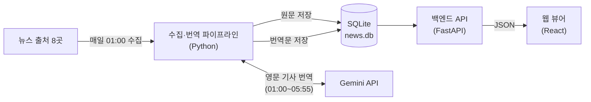

# AI 뉴스 브리핑 뷰어

해외 AI 원천 소식과 국내 IT·경제 뉴스를 매일 새벽 자동으로 모으고, 영문 기사를 한국어로 번역해 아침에 한곳에서 읽을 수 있게 해 주는 개인 뉴스 서비스입니다.


---

## 목차

- [만든 이유](#만든-이유)
- [주요 기능](#주요-기능)
- [화면](#화면)
- [동작 방식](#동작-방식)
- [수집 출처](#수집-출처)
- [기술 스택](#기술-스택)
- [프로젝트 구조](#프로젝트-구조)
- [시작하기](#시작하기)
- [상세 문서](#상세-문서)

---

## 만든 이유

AI 분야의 새 소식은 Reddit, GitHub, Hugging Face, arXiv 같은 해외 커뮤니티와 원천 사이트에서 먼저 나옵니다. 이 소식을 따라가려면 여러 사이트를 돌아다니며 영문 글을 읽어야 하고, 국내 뉴스는 또 따로 확인해야 합니다.

이 프로젝트는 그 과정을 자동화합니다.

- **한곳에서**: 국내외 8개 출처의 기사를 하나의 화면에 모읍니다.
- **한국어로**: 영문 기사는 제목과 본문을 한국어로 번역해 보여 줍니다.
- **아침에**: 사람이 자는 새벽 시간에 수집과 번역을 끝내, 출근 전에 바로 읽을 수 있습니다.
- **비용 없이**: 번역은 Google Gemini API 무료 티어 한도 안에서만 동작하도록 설계했습니다.

---

## 주요 기능

**수집과 번역**
- 매일 01:00(한국 시간)에 8개 출처에서 새 기사를 자동 수집합니다.
- 영문 기사의 제목과 본문을 Gemini로 한국어 번역합니다. 한국어 기사는 번역하지 않습니다.
- 무료 한도를 넘지 않도록 호출량을 조절하고, 05:55가 되면 새 번역 요청을 멈춥니다.
- 긴 기사는 문단 단위로 나눠 번역하고, 중간에 멈추면 다음 실행에서 남은 부분부터 이어서 번역합니다.

**읽기**
- **오늘의 AI 브리핑**: 최근 24시간의 AI 기사 중 주제와 출처가 고르게 섞이도록 최대 5개를 골라 첫 화면에 보여 줍니다.
- **검색과 필터**: 제목·본문·요약을 원문과 번역문 모두에서 검색하고, 카테고리와 출처로 걸러 볼 수 있습니다.
- **본문 읽기**: 번역이 끝난 기사는 한국어로, 아직이면 원문으로 보여 주며, Markdown 서식(코드, 목록, 링크, 이미지)을 그대로 살립니다.
- **반응형 화면**: PC에서는 메뉴·목록·본문 3단 구성, 휴대폰에서는 목록과 본문을 전환하며 읽습니다.

---

## 화면

| PC — 기사 목록 | 휴대폰 — 기사 목록 | 휴대폰 — 본문 |
| :---: | :---: | :---: |
|  |  |  |

밝은 배경과 녹색 강조색을 쓰는 읽기 중심 화면입니다. 기사마다 출처 배지, 날짜, 제목, 요약, 태그 순으로 정보를 배치했습니다.

---

## 동작 방식



1. **수집**: 수집 파이프라인이 각 출처에서 기사를 가져와 원문 그대로 SQLite에 저장합니다.
2. **번역**: 저장된 영문 기사 중 새로 들어온 기사부터 순서대로 Gemini에 번역을 요청하고, 결과를 같은 데이터베이스에 저장합니다.
3. **제공**: 백엔드 API가 원문과 번역문을 합쳐, 번역이 끝난 기사는 한국어로 돌려줍니다.
4. **표시**: 웹 뷰어가 API를 호출해 브리핑, 목록, 본문을 보여 줍니다.

---

## 수집 출처

| 출처 | 수집 내용 | 번역 |
| :--- | :--- | :---: |
| 네이버뉴스 | IT/과학, 경제, 국제 섹션 최신 기사 | 한국어 원문 |
| GeekNews | 국내 개발·기술·AI 토픽 | 한국어 원문 |
| Google News | 글로벌 경제·AI 뉴스 | 번역 |
| Reddit AI | `r/LocalLLaMA`, `r/singularity` 인기 글 | 번역 |
| GitHub Trending | 오늘의 트렌딩 저장소 중 AI·LLM 프로젝트 | 번역 |
| Hugging Face | 공식 블로그, Daily Papers | 번역 |
| arXiv | 컴퓨터 과학·AI 분야 논문 초록 | 번역 |
| dev.to | `ai` 태그 인기 기술 글 | 번역 |

---

## 기술 스택

| 영역 | 기술 |
| :--- | :--- |
| 수집·번역 | Python, `httpx`, `beautifulsoup4`·`lxml`, `trafilatura`(본문 추출), `APScheduler`(스케줄링), `google-genai`(Gemini `gemini-2.5-flash`) |
| 백엔드 | FastAPI, Uvicorn, Pydantic |
| 데이터베이스 | SQLite (수집 파이프라인과 백엔드가 같은 `news.db`를 공유) |
| 프론트엔드 | React 18, Vite 8, `react-markdown` |

---

## 프로젝트 구조

```
.
├── news-crawling/          # 수집·번역 파이프라인 (Python)
│   ├── crawlers/           #   출처별 수집기
│   ├── translation/        #   번역 대기열, 문단 분할, 한도 제어, Gemini 번역
│   ├── db.py               #   SQLite 스키마와 저장 함수
│   └── main.py             #   실행 진입점 (--run 1회 실행 / --schedule 매일 실행)
├── news-viewer/
│   ├── backend/            # 기사 조회 API (FastAPI)
│   └── frontend/           # 웹 뷰어 (React + Vite)
├── nginx/
│   ├── proxy/              # 엣지 프록시 설정 (활성 색으로 / 와 /api/ 전달)
│   └── web/                # 색상별 화면 정적 파일 서버 이미지
├── scripts/deploy.sh       # 블루-그린 배포 스크립트
├── docker-compose.yml      # core 스택 (proxy, crawler, 볼륨, 네트워크)
├── docker-compose.app.yml  # 색상별 앱 스택 (web, backend)
└── start.ps1               # Windows 통합 실행 스크립트
```

---

## 시작하기

### 준비

- Python 3, Node.js(npm)
- Gemini API 키: `news-crawling/.env` 파일에 `GEMINI_API_KEY=<발급받은 키>`를 적습니다. (이 파일은 Git에 올리지 않습니다.)

### 실행

```bash
# 1) 뉴스 수집·번역 (news-crawling/)
python -m pip install -r requirements.txt
python main.py --run          # 지금 1회 실행
python main.py --schedule     # 매일 01:00에 자동 실행

# 2) 백엔드 API (news-viewer/backend/) → http://localhost:8000/docs
python -m pip install -r requirements.txt
uvicorn main:app --reload

# 3) 웹 뷰어 (news-viewer/frontend/) → http://localhost:5173
npm install
npm run dev
```

Windows에서는 저장소 루트에서 `.\start.ps1`을 실행하면 백엔드와 웹 뷰어가 각각 새 창에서 시작됩니다. `.\start.ps1 -Crawl`을 쓰면 수집도 함께 1회 실행합니다.

### Docker로 실행 (라즈베리파이 등)

블루-그린 방식으로 무중단 교체할 수 있게 두 묶음으로 나눠 실행합니다. 공식 multi-arch 이미지를 쓰므로 Raspberry Pi OS 64bit(ARM64)에서도 그대로 빌드됩니다.

- **core 스택** (`docker-compose.yml`, 프로젝트 `news-project`): 외부 포트를 유일하게 여는 엣지 프록시 `proxy`(nginx), 수집기 `crawler`, 데이터 볼륨 `news-project_news-data`(`news.db`), 공유 네트워크 `news-edge`.
- **색상별 앱 스택** (`docker-compose.app.yml`, 프로젝트 `news-blue` / `news-green`): 화면 정적 파일 서버 `web`(빌드 결과가 `nginx/web` 이미지에 담김)과 API `backend`를 한 쌍으로 띄웁니다. `proxy`는 활성 색의 `web-<색>`으로 `/`를, `backend-<색>`으로 `/api/`(접두사 제거)를 보냅니다.
- **전제**: Docker Engine과 Compose 플러그인(`docker compose`, v2.24 이상), bash
- **설정**: `news-crawling/.env`에 `GEMINI_API_KEY=<발급받은 키>`를 적습니다. 파일이 없어도 실행되지만 번역은 건너뜁니다.

배포와 로컬 실행 모두 [`scripts/deploy.sh`](scripts/deploy.sh)를 사용합니다. 실행할 때마다 비활성 색을 새로 빌드·기동해 검증한 뒤 `proxy`를 그 색으로 전환(`nginx -t` 후 `nginx -s reload`)하고, 잠시 뒤 이전 색을 내립니다. 새 색이 헬스체크나 검증에 실패하면 이전 색으로 되돌리고 실패로 끝나므로 서비스는 이전 버전으로 계속 유지됩니다.

```bash
bash scripts/deploy.sh                 # 빌드 후 무중단 배포 → http://<장비 IP>/ (최초 실행도 이 명령)
WEB_PORT=8080 bash scripts/deploy.sh   # 80 포트가 사용 중이면 다른 포트로 노출(루트 .env에 WEB_PORT=8080도 가능)
bash scripts/deploy.sh status          # 활성 색과 서비스 상태
docker compose logs -f proxy           # core 로그 확인 (crawler도 동일)
docker compose -p news-blue logs -f    # 앱 스택 로그 확인 (활성 색 이름 사용)
docker compose run --rm crawler python main.py --run   # 지금 1회 수집
```

중지는 앱 스택부터 내린 뒤 core를 내립니다. 데이터 볼륨은 유지되며 `-v`를 붙이면 삭제됩니다.

```bash
DEPLOY_COLOR=blue  docker compose -p news-blue  -f docker-compose.app.yml down
DEPLOY_COLOR=green docker compose -p news-green -f docker-compose.app.yml down
docker compose down
```

- **활성 색 기록**: `.deploy/proxy/active.conf`(Git 무시)가 활성 색의 유일한 원천이며 `proxy`에 마운트됩니다. 직접 수정하지 마세요. 파일이 없으면 blue로 간주합니다.
- **proxy 설정 변경**: `nginx/proxy/conf.d/`는 `proxy`에 마운트되어 있어 배포 때 컨테이너 재생성 없이 reload로 반영됩니다. 문법 오류면 전환 전에 배포가 중단되고 기존 설정이 유지됩니다. 포트 매핑처럼 `proxy` 컨테이너 정의 자체가 바뀌면 재생성되어 수 초 중단될 수 있습니다.
- **crawler**: 블루-그린에서 제외한 단일 인스턴스입니다(두 개가 돌면 수집이 중복되고 Gemini 할당량을 두 배로 씁니다). 이미지나 정의가 바뀐 경우에만 교체하며, 수집 시간대(기본 00:50~06:00 KST, `news-crawling/.env`의 `SCHEDULE_*`·`DEADLINE_*` 값을 따르고 시작 10분 전부터 포함)에는 교체를 보류하고 경고만 남깁니다. 보류된 변경은 시간대가 지난 뒤 배포를 다시 실행하거나 `FORCE_CRAWLER=1 bash scripts/deploy.sh`로 강제해 반영합니다.
- **기존 구조에서 1회 전환**: 이전 구조(`news-project`의 `nginx`·`backend`)가 남아 있으면 스크립트가 감지해 새 구조로 옮깁니다. 새 blue 스택을 먼저 기동·검증한 뒤 이전 `nginx`·`backend`를 정리하고 `proxy`를 시작하므로 이 순간 1초 안팎 접속이 끊깁니다. `crawler`와 `news-project_news-data` 볼륨은 그대로 유지됩니다.

`crawler`는 매일 01:00(한국 시간)에 수집·번역을 실행합니다. 데이터베이스 백업과 복원은 다음과 같습니다.

```bash
# 백업: 현재 폴더에 news.db 복사
docker compose cp crawler:/data/news.db ./news.db.bak
# 복원: crawler와 활성 색 backend를 멈춘 뒤 볼륨에 덮어쓰기 (COLOR는 bash scripts/deploy.sh status의 활성 색)
COLOR=blue
docker compose stop crawler
docker compose -p "news-$COLOR" stop backend
docker run --rm -v news-project_news-data:/data -v "$PWD":/backup alpine \
  sh -c "cp /backup/news.db.bak /data/news.db && chown 1000:1000 /data/news.db"
docker compose -p "news-$COLOR" start backend
docker compose start crawler
```

#### 자동 배포 (GitHub Actions self-hosted runner)

`main`에 병합(push)되면 [`.github/workflows/deploy.yml`](.github/workflows/deploy.yml)이 라즈베리파이의 self-hosted runner(`self-hosted`, `linux`, `ARM64`)에서 실행됩니다. 배포 폴더 `/home/ms/news-project`를 `git merge --ff-only`로 갱신한 뒤 `bash scripts/deploy.sh`로 블루-그린 배포를 하고, 새 색이 검증에 실패하면 이전 색으로 되돌린 채 실패로 표시합니다. 실행 요약에는 활성 색과 서비스 상태가 남습니다. 문서(`*.md`) 등 실행과 무관한 파일만 바뀐 push는 배포하지 않습니다.

- **최초 1회 준비** (러너 사용자 `ms`로 실행): 배포 폴더는 러너 작업 폴더(`_work`)와 별개입니다.

  ```bash
  git clone https://github.com/SonSeYoung02/news-project.git /home/ms/news-project
  cd /home/ms/news-project
  echo "GEMINI_API_KEY=<발급받은 키>" > news-crawling/.env   # 외부 포트를 바꾸려면 루트 .env에 WEB_PORT=8080
  bash scripts/deploy.sh
  ```

- **동작 조건**: 배포 폴더의 추적 파일에 로컬 변경이 있으면 덮어쓰지 않고 실패합니다. `.env`, `*.db` 같은 Git 무시 파일은 영향을 주지 않습니다. 배포 폴더 경로는 워크플로의 `env.APP_DIR`에서 바꿉니다.
- **실패 로그**: 배포가 실패하면 컨테이너 로그는 파이의 `~/deploy-logs/`에 저장되며(최근 20개 유지, 권한 600) 공개된 Actions 로그에는 출력하지 않습니다. Actions에는 서비스 상태(`docker compose ps -a`)와 로그 파일 경로만 남습니다.
- **수동 실행**: GitHub 저장소의 **Actions → Deploy (Raspberry Pi) → Run workflow**에서 브랜치 `main`을 선택해 실행합니다. 수집 시간대에 보류된 crawler 교체를 바로 반영하려면 `force_crawler`를 선택합니다.
- **1회 전환 후 실패 시 수동 복구**: 1회 전환 중 이전 구조를 정리한 뒤 실패하면 자동으로 되돌릴 대상이 없습니다. 파이에서 `bash scripts/deploy.sh status`와 `~/deploy-logs/`를 확인한 뒤 원인을 고쳐 다시 배포합니다.
- **보안 주의**: 공개 저장소이므로 이 워크플로는 `main` push와 수동 실행에서만 동작하며 `pull_request` 트리거를 쓰지 않습니다. 다만 포크 PR은 자기 브랜치의 워크플로 파일에서 `runs-on: self-hosted`를 지정해 이 러너를 쓸 수 있으므로, 다음 승인 설정이 필수입니다. **Settings → Actions → General → Fork pull request workflows from outside collaborators**를 "Require approval for all external contributors"로 설정해 외부 기여자 코드가 러너에서 실행되지 않게 합니다.

---

## 상세 문서

| 문서 | 내용 |
| :--- | :--- |
| [news-crawling/README.md](news-crawling/README.md) | 수집·번역 파이프라인 동작, 번역 운영 정책, 환경 설정 |
| [news-viewer/backend/README.md](news-viewer/backend/README.md) | API 명세, 응답 필드, 데이터베이스 연동 |
| [news-viewer/frontend/README.md](news-viewer/frontend/README.md) | 화면 구성, 디자인, 빌드·배포 |
